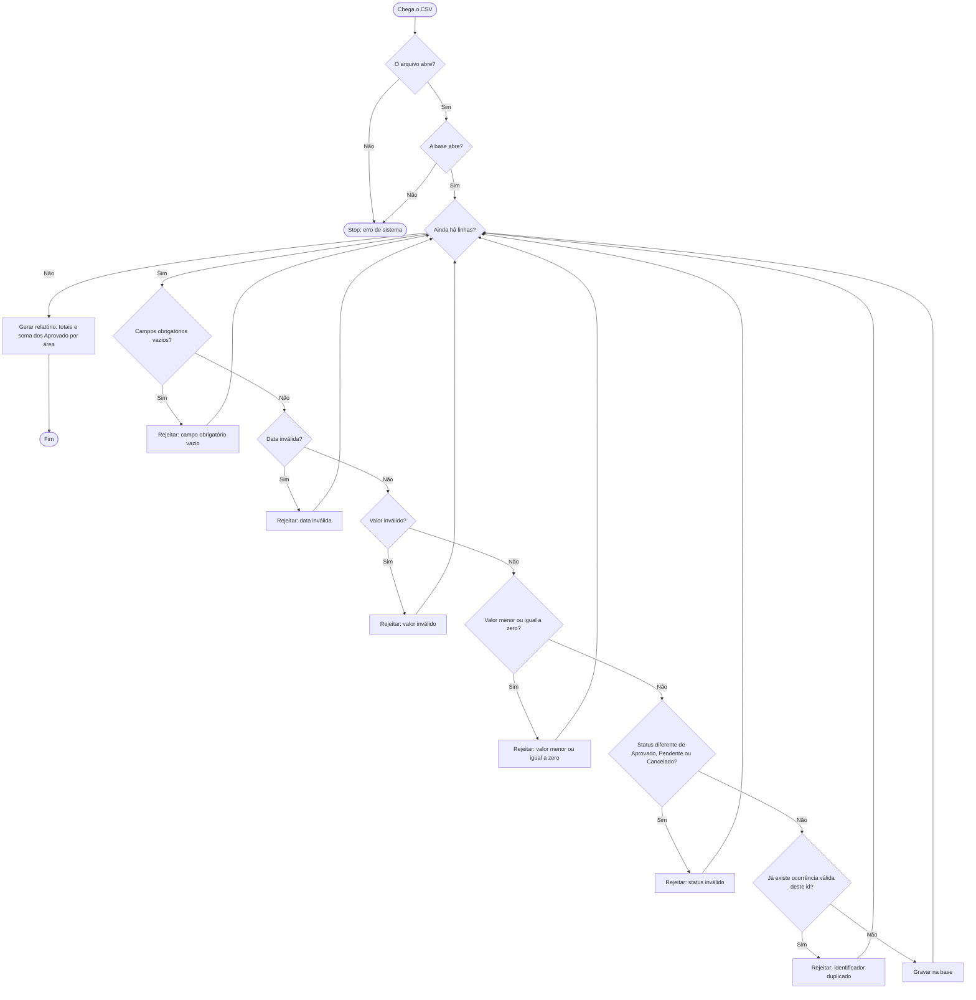

AS-IS:

Recebe-se um arquivo CSV com os registros de solicitações. Em seguida, uma pessoa confere cada linha e separa os registros inválidos, anotando o motivo. Depois da conferência, lança no sistema apenas os registros válidos e, com esses lançamentos, elabora o relatório com o total financeiro dos registros aprovados.

TO-BE:

Exceções de negócio: linha rejeitada, com o motivo, no arquivo de rejeições. O lote continua.

Exceção de sistema: o arquivo ou a base não abre. A execução para. Não se processam linhas.

Decisão: status fora de Aprovado, Pendente e Cancelado é rejeitado. Duplicado significa a segunda ocorrência válida do mesmo id, nesta execução ou já gravada na base. Só Aprovado entra na soma financeira. Pendente e Cancelado válidos são gravados e não entram nessa soma.

